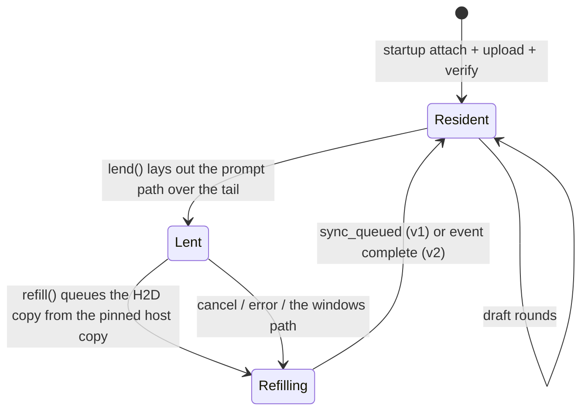
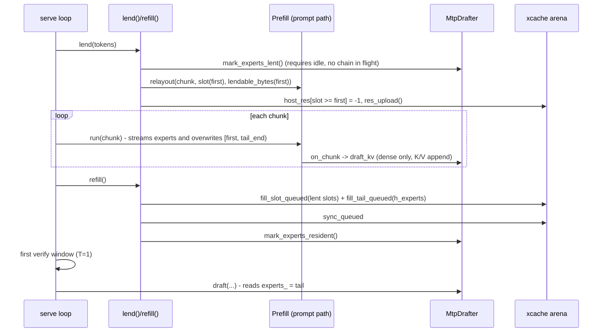

# Design: lending the MTP draft layer's experts to the prompt path (`--mtp-lend`)

| | |
|---|---|
| **Repo** | `Niko1221/Strata` @ `a0116b2` (2026-10-12), local clone at `~/Strata` (`/usr/local/google/home/jiamin/Strata`) |
| **Scope** | CUDA + HIP engine (`src/`, `include/`). The SYCL tree (`sycl/`) is out of scope |
| **Status** | Proposal. Nothing implemented, nothing measured |
| **Default behavior** | Unchanged. The feature is opt-in and the default path stays byte-identical (AGENTS.md rule) |

---

## 0. TL;DR

- The MTP draft layer keeps **512 routed experts × 1,382,400 B = 675 MiB** in VRAM for the whole session ([mtp.cpp L297-L320](file:///usr/local/google/home/jiamin/Strata/src/core/mtp.cpp#L297-L320)).
- During **prefill** the draft layer only appends its own **K/V**, which uses its *dense* weights alone ([`record_forward(T, -1)`](file:///usr/local/google/home/jiamin/Strata/src/core/mtp.cpp#L686-L693), [`Prefill::draft_kv`](file:///usr/local/google/home/jiamin/Strata/src/prefill/prefill.cpp#L1346-L1385)). The experts are read in exactly one place, `record_rest` → `moe_group_resident(..., experts_, ...)` ([L932](file:///usr/local/google/home/jiamin/Strata/src/core/mtp.cpp#L932)), which only runs inside draft rounds.
- Strata already lends the prompt path **the tail of the expert-cache arena** and refills it before decode ([`lend`/`refill`](file:///usr/local/google/home/jiamin/Strata/src/program/generate.cpp#L10838-L10970)).
- **Design:** move the 675 MiB MTP expert block **into the cache arena, right after the last slot** (the "MTP tail"). The prompt path's loan then always includes the tail, so it borrows ~512 fewer main-expert slots for the same chunk, or affords a larger chunk under the same cap. `refill()` copies the tail back from a pinned host copy before decoding starts.
- **Gain:** prefill only, mostly on 8–12 GB cards where the loan cap limits the auto chunk. Decode tok/s is unchanged, because decode needs the MTP experts *and* the cache.
- **Hardware:** the design adds no kernels and uses only `cudaMalloc`, `cudaHostAlloc`, `cudaMemcpyAsync` and events, so it runs on every discrete card the engine supports. The RTX 2080 Ti (11 GB, Turing, PCIe 3.0) is one of the cards that should gain most. See [Appendix A](#appendix-a-hardware-compatibility).

---

## 1. Background: how VRAM is used today

### 1.1 Startup order (single GPU, `serve`)

| # | Step | Where | VRAM |
|---|---|---|---|
| 1 | CUDA context, dense weight arena | [generate.cpp L3048](file:///usr/local/google/home/jiamin/Strata/src/program/generate.cpp#L3048) | dense weights |
| 2 | Session (KV, GDN state, PLE history) | [L4316](file:///usr/local/google/home/jiamin/Strata/src/program/generate.cpp#L4316) | KV, etc. |
| 3 | Batch slot sessions (`--batch`) | [L4440-L4478](file:///usr/local/google/home/jiamin/Strata/src/program/generate.cpp#L4440-L4478) | per slot |
| 4 | **MTP drafter `load()`**: dense blob (~111 MiB), **512 experts (675 MiB)**, own K/V, buffers | [L4480-L4532](file:///usr/local/google/home/jiamin/Strata/src/program/generate.cpp#L4480-L4532) | ~0.9 GB |
| 5 | Native head | [L4534-L4553](file:///usr/local/google/home/jiamin/Strata/src/program/generate.cpp#L4534-L4553) | ~0.5 GB |
| 6 | **Expert cache** sized from free VRAM minus the reserve, opened, profile-filled | [L5060-L5265](file:///usr/local/google/home/jiamin/Strata/src/program/generate.cpp#L5060-L5265) | "the rest" |
| 7 | Prompt path init with a **borrow** (loan) of the cache tail | [L6955-L7300](file:///usr/local/google/home/jiamin/Strata/src/program/generate.cpp#L6955-L7300) | inside the cache |
| 8 | Verifier, drafter `bind()` (draft head subset), `prepare_prefill`, `prepare_chain` | [L7611-L7749](file:///usr/local/google/home/jiamin/Strata/src/program/generate.cpp#L7611-L7749) | small |

The cache is sized after the drafter, so the 675 MiB comes straight out of the cache.

### 1.2 What the draft layer computes, and when

| Phase | Entry point | Graph | Needs dense | Needs **experts** |
|---|---|---|---|---|
| Prompt (batched, E-9) | `Prefill::draft_kv` (from `on_chunk`) | prompt path kernels, scratch in `m.region` (the loan) | ✅ | ❌ |
| Prompt (fallback) | `MtpDrafter::prefill` | `capture_prefill[_dev]` → `record_forward(T, -1)` = `record_front` only | ✅ | ❌ |
| Prompt via verify windows (short parts) | `mtp.prefill(v.final_R(0), ...)` [L10749](file:///usr/local/google/home/jiamin/Strata/src/program/generate.cpp#L10749) | same K/V-only graph | ✅ | ❌ |
| Decode, first round | `draft()` with `first_window`, `draft_first()` (batch admission) | `capture_round` → `record_front` + **`record_rest`** | ✅ | ✅ |
| Decode, chain steps | `capture_step` → `record_forward(1, row)` | full layer | ✅ | ✅ |
| `--pipeline-windows 2` | `chain_launch` | round + steps | ✅ | ✅ |
| `--batch-mtp` slot drafters | `slot_mtp[b]->draft / draft_first` (share `experts_`) | full layer | ✅ | ✅ |

### 1.3 The existing loan

- At startup `plan_lend` picks the chunk. With `--prefill auto` it takes the largest chunk whose `Prefill::bytes_needed(chunk)` fits in at most **85–90 %** of the slots (`kAutoLendPct`) while leaving **128 slots** ([L6350-L6420](file:///usr/local/google/home/jiamin/Strata/src/program/generate.cpp#L6350-L6420)).
- Per request, `lend(tokens)` computes `first = slots − need`, calls `Prefill::relayout(chunk, device_slot(first), part_bytes(first))`, marks every resident `(layer, expert)` with `slot ≥ first` as missing in `host_res`, and calls `res_upload()`.
- `refill()` copies each lent blob back into the *same* slot from the expert source (`fill_slot_queued` + `sync_queued`), restores `host_res`, and calls `res_upload()`. It runs before any verify window: on the "windows" path, after the prompt, and on cancel/error ([L11186-L11243](file:///usr/local/google/home/jiamin/Strata/src/program/generate.cpp#L11186-L11243)).
- With `--batch`, slots may **decode between prompt chunks** (`in_prompt_read`, `STRATA_BATCH_DECODE_SHARE`, [L11050-L11070](file:///usr/local/google/home/jiamin/Strata/src/program/generate.cpp#L11050-L11070)). The lent experts just look like CPU misses to those windows.

---

## 2. Goals and non-goals

**Goals**
1. While a prompt is read, the MTP experts' 675 MiB is part of the prompt path's borrowed region.
2. Before any draft round, all 512 MTP experts are back in VRAM, byte-exact, at the **same device address** (captured graphs hold the pointer).
3. The default path is byte-identical. The feature is opt-in (`--mtp-lend` / `STRATA_MTP_LEND=1`).
4. No change to emitted tokens. Greedy output must be bit-identical with the feature on or off.

**Non-goals (v1)**
- A bigger cache **during decode**. See Option C in §11.
- Layer splits (multi-GPU), `--vram-elastic`, `--kv-grow`, SYCL. The feature turns itself off with a log line.
- Changing MTP numerics.

---

## 3. Design overview

### 3.1 Memory layout

```
 xcache arena (ONE allocation: cudaMalloc, or VMM in a later phase)
 ┌──────────── slots [0, S) : main experts (residency table) ─────────────┬─pad─┬──── MTP tail (675 MiB) ────┐
 │ slot 0 │ slot 1 │ ... │ slot first ... slot S-1                       │ ≤255│ expert 0 ... expert 511    │
 └────────────────────────────────────────────────────────────────────────┴─────┴────────────────────────────┘
                              ▲ loan region (prompt path) = [slot_offset(first), tail_end)
```

- The tail starts at `align256(slot_end(S))`. Because it's in the same allocation, `[slot_offset(first), tail_end)` is one contiguous range, which is what `Prefill::init/relayout(chunk, borrow, borrow_bytes)` requires.
- `slots()`, `bytes()`, `full_slots()`, the residency table, `admit`, the adaptive tier and the profile fill **never see the tail**.
- `MtpDrafter::experts_` points at `xcache.tail()` for the whole session, so its graphs never need re-capturing.

### 3.2 Tail states



Invariant: **draft rounds (`draft`, `draft_first`, `chain_launch`) only run when the tail is `Resident`.** In v2 the drafter's stream waits on the refill event, which gives the same guarantee.

### 3.3 One request (single GPU)



---

## 4. Detailed changes

### 4.1 Options, flag and auto-disable rules (`src/program/generate.cpp`)

**4.1.1 Options struct** (next to `batch_mtp`, [L561](file:///usr/local/google/home/jiamin/Strata/src/program/generate.cpp#L561)):
```cpp
bool mtp_lend = false;   ///< --mtp-lend / STRATA_MTP_LEND=1 (opt-in): the drafter's 512 experts live at the tail of the
                         ///< expert cache and are lent to the prompt path with it, refilled before the first draft
```

**4.1.2 Parser** (next to `--mtp`, [L2032](file:///usr/local/google/home/jiamin/Strata/src/program/generate.cpp#L2032)):
```cpp
else if (a == "--mtp-lend") o.mtp_lend = true;
else if (a == "--no-mtp-lend") o.mtp_lend = false;
```
Read the env var once after parsing: `if (const char* v = std::getenv("STRATA_MTP_LEND")) o.mtp_lend = v[0] == '1';`.

**4.1.3 Help text** (the usage block around [L711](file:///usr/local/google/home/jiamin/Strata/src/program/generate.cpp#L711)):
```
  --mtp-lend           the MTP draft layer's experts (675 MiB) are lent to the prompt path with the cache's
                       tail and copied back before the first draft (one GPU; opt-in)
```

**4.1.4 Auto-disable rules.** Decide these **before step 4 of startup** (the drafter load). Each one prints `strata generate: --mtp-lend is off: <why>` and clears `o.mtp_lend`.

| Condition | Reason |
|---|---|
| `o.mtp.empty()` or `o.spec < 2` | no drafter |
| `multi_gpu` (layer split) | the drafter lives on the last stage, whose cache is a `GpuStage::cache`. Phase 3 |
| `o.vram_elastic` | `ExpertCache::shrink()` unmaps the arena's tail segments, which would include the MTP tail |
| `o.kv_grow` / `ExpertCache::set_vmm(true)` | the VMM arena gives chunks to the K/V from the top. Phase 3 |
| `o.no_prefill_borrow` or `o.prefill_chunk <= 0` | no loan, so nothing to gain |
| `o.expert_cache == 0` (resolved) | no arena to attach to |
| any `o.expert_cache_remote[i] > 0` | helper caches. Keep v1 simple |
| a pinned host buffer of 675 MiB can't be allocated (§4.3.4) | without it the refill would be pageable and slow. The drafter allocates normally instead |
| the device is integrated / unified memory (`cudaDevAttrIntegrated`, e.g. DGX Spark GB10, Strix Halo iGPU; see `device_free_bytes()`) | "VRAM" and RAM are the same memory: the pinned host copy would hold 675 MiB twice and nothing crosses PCIe, so there's nothing to win (Appendix A) |

### 4.2 `ExpertCache`: an optional tail

**Files:** [`include/strata/core/expert_cache.hpp`](file:///usr/local/google/home/jiamin/Strata/include/strata/core/expert_cache.hpp), [`src/core/expert_cache.cpp`](file:///usr/local/google/home/jiamin/Strata/src/core/expert_cache.cpp).

**4.2.1 Public API additions**
```cpp
/// --mtp-lend: `bytes` of device memory after the last slot, in the same allocation (256-byte aligned start), for a
/// caller-owned block that the prompt path's loan may cover.  Applies to the next open/open_sized; 0 = none (default).
/// Refused (open fails with err) together with set_segment_bytes(>0) or set_vmm(true).
void set_tail_bytes(uint64_t bytes) { tail_req_ = bytes; }
uint8_t* tail() { return tail_bytes_ ? base_ + tail_off_ : nullptr; }
const uint8_t* tail() const { return tail_bytes_ ? base_ + tail_off_ : nullptr; }
uint64_t tail_bytes() const { return tail_bytes_; }
/// Bytes from slot `first`'s start to the end of the allocation (the tail included): what a loan starting at
/// `first` may lay its buffers out over.  first == slots(): the tail alone.
uint64_t lendable_bytes_from(int64_t first) const;
/// The tail's copy from the host, queued on the same (legacy) stream as fill_slot_queued; sync_queued waits for both.
bool fill_tail_queued(const uint8_t* host, uint64_t bytes, std::string& err);
/// Byte-compares the tail with `host` (reads back in 64 MiB pieces).  Startup and STRATA_MTP_LEND_VERIFY=1 only.
bool verify_tail(const uint8_t* host, uint64_t bytes, std::string& err);
```

**4.2.2 Private members**
```cpp
uint64_t tail_req_ = 0;     ///< --mtp-lend: asked for
uint64_t tail_off_ = 0;     ///< the tail's offset in the arena (align256(slot_end(slots_)))
uint64_t tail_bytes_ = 0;   ///< 0: no tail
```

**4.2.3 `open()` ([L469](file:///usr/local/google/home/jiamin/Strata/src/core/expert_cache.cpp#L469))**
- `want = n_slots * blob_bytes` becomes `slot_bytes_total = n_slots * blob_bytes; tail_off = align256(slot_bytes_total); want = tail_off + tail_req_`.
- The free-VRAM check, the `cudaMalloc` and the `cudaMemset` all use the new `want`. The refusal text names the tail when it isn't zero: `"... + %.2f GiB MTP tail"`.
- If `tail_req_ > 0 && (seg_req_ > 0 || g_cache_vmm)`: `err = "ExpertCache: an MTP tail needs a plain allocation"; return false;`.
- On success set `tail_off_ = tail_off; tail_bytes_ = tail_req_`.

**4.2.4 `open_sized()` ([L561](file:///usr/local/google/home/jiamin/Strata/src/core/expert_cache.cpp#L561))**
- It builds `off[]` (256-aligned) and allocates `off.back()` bytes through the uniform path. Add `tail_req_` the same way: `tail_off = off.back()` (already 256-aligned), `want = tail_off + tail_req_`.
- `off_` keeps `slots + 1` entries. Nothing in `off_` refers to the tail.

**4.2.5 `close()`**: reset `tail_off_ = tail_bytes_ = 0`. Don't reset `tail_req_`, because the WDDM retry loop reopens.

**4.2.6 `lendable_bytes_from(first)`**
```cpp
uint64_t ExpertCache::lendable_bytes_from(int64_t first) const {
    if (first < 0) first = 0;
    if (first > live_slots_) first = live_slots_;
    const uint64_t end = tail_bytes_ ? tail_off_ + tail_bytes_ : (uint64_t) slot_end(live_slots_);
    return end - slot_offset(first);
}
```
With no tail this equals today's `part_bytes(p, first)` for sized slots, and `(slots − first) × blob` for uniform ones. So callers can switch to it without changing behavior.

**4.2.7 `fill_tail_queued` / `verify_tail`**: these mirror `fill_slot_queued` ([L723](file:///usr/local/google/home/jiamin/Strata/src/core/expert_cache.cpp#L723)) and `verify_slot`, using the same legacy-stream `cudaMemcpyAsync`. `fill_tail_queued` takes one call for the whole block, because the source is pinned and contiguous. **HIP:** never send the tail through `fill_slot_blocking`'s HIP staging path (`STRATA_REFILL_BLOCKING=1`). Its staging buffer holds one expert (`blob_`), and a pinned source doesn't need staging. If blocking mode is forced, copy the tail with a plain blocking `cudaMemcpy` from the pinned buffer.

**4.2.8 `shrink`/`grow`**: unreachable with a tail (refused at open). Add `if (tail_bytes_) { err = "..."; return false; }` as a guard.

### 4.3 `MtpDrafter`: deferred experts

**Files:** [`include/strata/core/mtp.hpp`](file:///usr/local/google/home/jiamin/Strata/include/strata/core/mtp.hpp), [`src/core/mtp.cpp`](file:///usr/local/google/home/jiamin/Strata/src/core/mtp.cpp).

**4.3.1 Public API additions**
```cpp
/// --mtp-lend (before load): load() reads experts.bin into a pinned host copy instead of VRAM; the device block is
/// given later by attach_experts (the expert cache's tail).  False from load when the pinned copy cannot be made.
void set_defer_experts(bool on) { defer_experts_ = on; }
bool defer_experts() const { return defer_experts_; }
/// The routed experts' size (n_expert x BLOB of the draft geometry): what the cache's tail must hold.
uint64_t expert_bytes() const;
/// Points experts_ at `dev` (expert_bytes() long, on this drafter's device), uploads the host copy, waits, verifies.
/// Before bind()/prepare_chain()/any draft: the round and step graphs capture the pointer.
bool attach_experts(uint8_t* dev, std::string& err);
/// The pinned host copy (null unless deferred): refill() copies it back into the tail.
const uint8_t* host_experts() const { return owner()->h_experts_; }
/// Whether experts_ holds the weights now.  Slot drafters (shared weights) answer for their owner.
bool experts_resident() const { return owner()->experts_resident_; }
/// lend(): the tail is about to be overwritten.  Requires no draft work in flight (syncs cs_; refuses with
/// chain_live()).  refill(): the tail holds the weights again (after the copy has completed).
bool mark_experts_lent(std::string& err);
void mark_experts_resident() { experts_resident_ = true; }
```
- `owner()` returns `shared_owner_ ? shared_owner_ : this`. `shared_owner_` is the `shared` pointer passed to `load()`, stored for slot drafters.

**4.3.2 Private members**
```cpp
bool defer_experts_ = false;
bool experts_resident_ = true;   ///< false only between lend() and refill() under --mtp-lend
uint8_t* h_experts_ = nullptr;   ///< pinned host copy (cudaHostAlloc, portable) when deferred
const MtpDrafter* shared_owner_ = nullptr;
bool experts_in_cache_ = false;  ///< experts_ points into the expert cache: never cudaFree it
```

**4.3.3 `load()` ([L245-L472](file:///usr/local/google/home/jiamin/Strata/src/core/mtp.cpp#L245-L472))**
- **Shared (slot drafter) branch.** Today it refuses when `shared->experts_ == nullptr`. Change that to `(shared->experts_ == nullptr && !shared->defer_experts_)`, set `shared_owner_ = shared`, and copy `experts_ = shared->experts_` (which may be null for now; see §4.4 step 7b).
- **Experts block (`if (shared == nullptr)`, L297-L320).** If `defer_experts_`:
  ```cpp
  if (cudaHostAlloc((void**) &h_experts_, bytes, cudaHostAllocPortable) != cudaSuccess) {
      cudaGetLastError(); h_experts_ = nullptr;
      err = "mtp: --mtp-lend: no pinned RAM for the experts' host copy"; return false;   // caller falls back
  }
  // read experts.bin straight into h_experts_ (the same fread loop, 64 MiB at a time, no chunk vector)
  experts_ = nullptr; experts_resident_ = false;   // until attach_experts
  // vram_ does NOT count the experts (the cache's tail does)
  ```
  Otherwise keep the current code unchanged.
- The `"draft layer loaded, %.0f MiB of VRAM (experts %.0f, dense %.0f)"` log gets a deferred variant: `"... experts deferred to the expert cache's tail (--mtp-lend), %.0f MiB pinned host copy"`.

**4.3.4 Fallback.** If `load()` fails with the pinned-RAM error, the caller logs `--mtp-lend is off: ...`, calls `set_defer_experts(false)`, and calls `load()` again. A partial first `load()` must leave the object reusable, so add a `reset_for_reload()` that frees what was allocated. The simpler alternative is to try `cudaHostAlloc` first in generate.cpp, before `load()`.

**4.3.5 `attach_experts(dev, err)`**
```cpp
if (!defer_experts_ || shared_owner_ != nullptr || h_experts_ == nullptr || dev == nullptr) { err = "..."; return false; }
const OnDevice on(device_);
experts_ = dev; experts_in_cache_ = true;
cudaMemcpy(experts_, h_experts_, expert_bytes(), cudaMemcpyHostToDevice);   // blocking; startup only
// verify: read back and memcmp in 64 MiB pieces (the project's "a slot that is right about indices and wrong about
// bytes produces a plausible token" rule)
experts_resident_ = true;
```
Slot drafters pick up the pointer through a new `void sync_shared_experts() { experts_ = shared_owner_->experts_; }`, which runs before any capture (§4.4 step 7b).

**4.3.6 Destructor ([L130-L162](file:///usr/local/google/home/jiamin/Strata/src/core/mtp.cpp#L130-L162))**: change
`if (owns_weights_ && experts_) cudaFree(experts_);` to
`if (owns_weights_ && experts_ && !experts_in_cache_) cudaFree(experts_);`, and add `if (h_experts_) cudaFreeHost(h_experts_);`.
Destruction order matters: `mtp` is declared before `xcache` in `generate.cpp`, so `xcache` is destroyed first. The drafter never touches `experts_` in its destructor apart from the guarded free, so this is safe. Note it in a comment.

**4.3.7 Defensive guards inside the drafter.** Add at the top of `draft()`, `draft_first()`, `chain_launch()`, and before any `capture_round`/`capture_step`:
```cpp
if (!experts_resident()) { err = "mtp: the draft layer's experts are lent to the prompt path (--mtp-lend)"; return false; }
```
These should never fire. The call sites guard first (§4.7). They exist so a missed call site fails loudly instead of drafting from prompt buffers. Garbage weights only affect drafts, not output, but NaN logits could make argmax return an out-of-range id.

**4.3.8 `mark_experts_lent(err)`**
```cpp
if (owner() != this) { err = "mtp: lend through the owner"; return false; }
if (chain_live_) { err = "mtp: a pipelined chain is still in flight"; return false; }
if (cs_ && cudaStreamSynchronize(cs_) != cudaSuccess) { err = "mtp: its stream failed"; return false; }
experts_resident_ = false; return true;
```
`--batch-mtp` slot drafters run on their own streams. `lend()` syncs each of them too (§4.6).

### 4.4 Startup sequencing (`generate.cpp`)

The new steps are in **bold**. Everything else stays where it is.

1. Parse options and apply the auto-disable rules (§4.1.4).
2. Drafter load ([L4480-L4532](file:///usr/local/google/home/jiamin/Strata/src/program/generate.cpp#L4480-L4532)): **`mtp.set_defer_experts(o.mtp_lend)` before `mtp.load(...)`**. On the pinned-RAM failure, fall back (§4.3.4).
3. **Placeholder reservation.** Right after the drafter load, when `mtp.defer_experts()`:
   ```cpp
   void* mtp_tail_hold = nullptr;   // keeps the tail's VRAM out of every free-VRAM reading until xcache.open
   if (cudaMalloc(&mtp_tail_hold, mtp.expert_bytes()) != cudaSuccess) { /* same failure text as today's experts */ }
   ```
   This keeps the change small. Every cache-sizing rule (uniform `auto`, native-pack `sized_slots` [L5035-L5058](file:///usr/local/google/home/jiamin/Strata/src/program/generate.cpp#L5035-L5058), per-layer slots, the WDDM write-and-re-read loop [L5112-L5185](file:///usr/local/google/home/jiamin/Strata/src/program/generate.cpp#L5112-L5185), `vram_reserve_mib`) sees **exactly the free VRAM it sees today**, so the slot count is identical to the default build. Without it, each of those rules would need a `− tail` term.
4. Native head, logits, contexts: unchanged.
5. **Immediately before each `xcache.open/open_sized` attempt** ([L5129-L5131](file:///usr/local/google/home/jiamin/Strata/src/program/generate.cpp#L5129-L5131)):
   ```cpp
   if (mtp_tail_hold) { cudaFree(mtp_tail_hold); mtp_tail_hold = nullptr; }
   xcache.set_tail_bytes(mtp.defer_experts() ? mtp.expert_bytes() : 0);
   ```
   The retry loop reopens smaller on failure. The tail is part of every attempt, so the slot region shrinks and the tail never does. Log `strata generate: --mtp-lend: the draft layer's 512 experts (675 MiB) at the end of the expert cache`.
6. Profile fill / `verify_slot`: unchanged (slots only).
7. **Attach**, after the cache is open and before the prompt-path init (step 7 of §1.1):
   - a. `if (mtp.defer_experts() && !mtp.attach_experts(xcache.tail(), err)) → fatal "strata generate: --mtp-lend: <err>"`.
   - b. For each `slot_mtp[b]`: `slot_mtp[b]->sync_shared_experts()`.
   - c. `mem_mark("the draft layer's experts (the cache's tail)")`.
8. Prompt path init with the borrow ([L7226-L7300](file:///usr/local/google/home/jiamin/Strata/src/program/generate.cpp#L7226-L7300)): see §4.5.
9. `bind`, `prepare_prefill`, `prepare_chain`: unchanged. They now capture `experts_ = xcache.tail()`.

> [!NOTE]
> On Windows, [L4480](file:///usr/local/google/home/jiamin/Strata/src/program/generate.cpp#L4480) warns that WDDM can refuse the draft weights *after* the host arena is registered. The expert cache is already allocated after that point and has a retry loop for exactly this. Folding the tail into that one allocation means the 675 MiB is covered by the same retry: the slot region shrinks and the tail stays. The placeholder from step 3 is allocated *before* registration, so the free-VRAM figure is reserved early. Test on Windows (§9.4).

### 4.5 Loan sizing math (`generate.cpp`)

Let **`Tb = xcache.tail_bytes()`** (0 without the feature). Every change below reduces to today's code when `Tb == 0`.

**4.5.1 Generate-path helpers** ([L6302-L6322](file:///usr/local/google/home/jiamin/Strata/src/program/generate.cpp#L6302-L6322))
```cpp
auto slots_from_bytes = [&](uint64_t need) -> int64_t {
    need = need > Tb ? need - Tb : 0;          // NEW: the tail covers the first Tb bytes of any loan
    if (need == 0) return 0;                    // NEW (a loan that the tail alone holds)
    ... unchanged ...
};
auto bytes_from_slots = [&](int64_t k) -> uint64_t {
    if (k <= 0) return Tb;                      // was: 0
    return xcache.lendable_bytes_from(xcache.slots() - k);   // == old value + Tb (+ alignment pad)
};
```
- `lend_slots(c)` is unchanged and inherits the new `slots_from_bytes`.

**4.5.2 `plan_lend` / `old_rule` / the auto scan** ([L6360-L6420+](file:///usr/local/google/home/jiamin/Strata/src/program/generate.cpp#L6360))
- The tests `k + 128 <= xcache.slots()` and `k * 100 <= kAutoLendPct * xcache.slots()` stay **as they are, on `k` (main slots only)**. The cap protects the decode cache's experts during a prompt. The tail costs no hit rate, so it shouldn't count against the cap.
- `k == 0` currently means "nothing fits / no loan" in several places (`if (k > 0) {...}`). With a tail, a small chunk can need `k == 0` main slots and still be a valid loan (tail only). Introduce `const bool tail_loan = Tb > 0 && Prefill::bytes_needed(g, ss, c, src) <= Tb;` and treat `k > 0 || tail_loan` as "a loan". Every `if (k > 0)` / `k = 0` sentinel in `plan_lend`, the serve block (`fits_one`) and the one-shot path needs auditing for this. **This is the most error-prone part of the change** (see §8.1).
- The byte-budget ring (`budget = min(slots − 128, pct·slots/100)`, then "hand the ring what the smallest participant leaves over") gets `+ Tb` added to the participant-0 room *in bytes* before converting back to ring slots. A ring slot is `max_blob` bytes, so `ring_room_bytes += Tb` gives ~512 more ring slots on Q2_0-sized blobs, capped as before by `ring_cap()` / `ring_max_slots()`.

**4.5.3 Serve block, `PfPart` helpers** ([L7000-L7015](file:///usr/local/google/home/jiamin/Strata/src/program/generate.cpp#L7000-L7015))
```cpp
auto cache_slots_for = [&](const strata::core::ExpertCache& xc, uint64_t need) -> int64_t {
    const uint64_t t = xc.tail_bytes();                       // NEW (0 except CUDA0 under --mtp-lend)
    need = need > t ? need - t : 0;
    if (need == 0) return 0;
    return strata::program::split_lend_slots(xc.slots(), xc.bytes(), xc.slot_offsets(), max_blob, need);
};
auto part_bytes = [&](const PfPart& p, int32_t first) -> uint64_t {
    return p.cache->lendable_bytes_from(first);              // was: bytes() - offset[first]  /  (slots-first)*max_blob
};
```
- `fits_one`: `if ((k <= 0 && !tail_only(p, c)) || k + 128 > slots) return false;`.
- Startup `borrow` / `borrow_bytes` / `lend_first` for participant 0: `borrow = xcache.device_slot(lend_first)` where `lend_first` may now equal `xcache.slots()`. `device_slot(slots())` must return `base_ + slot_offset(slots())`, which is the tail's region (the pad is up to 255 B). Add a dedicated `ExpertCache::loan_base(first)` that returns `base_ + slot_offset(first)` for `first ∈ [0, slots()]`, so `device_slot`'s bounds check stays strict.
- The log `"prompt path borrows %lld of its %lld slots (%.2f GiB)"` becomes `"... %lld of its %lld slots + the MTP tail (%.2f GiB)"`.

**4.5.4 One-shot `generate` path** ([L12565-L12610](file:///usr/local/google/home/jiamin/Strata/src/program/generate.cpp#L12565-L12610))
- It uses the same `plan_lend` / `lend_slots`. Change `borrow_bytes` to `xcache.lendable_bytes_from(first)` and `borrow` to `xcache.loan_base(first)`. Before the `host_res` marking, call `mtp.mark_experts_lent(err)` when the tail is in the loan. In the "refill the lent slots" block after `prefill.run`, queue `fill_tail_queued` + sync, then call `mtp.mark_experts_resident()` before the first `draft_first` ([L13119](file:///usr/local/google/home/jiamin/Strata/src/program/generate.cpp#L13119)).

### 4.6 `lend()` at request time ([L10898-L10970](file:///usr/local/google/home/jiamin/Strata/src/program/generate.cpp#L10898-L10970))

Changes, only for participant 0 when `Tb > 0`:
1. **Before relayout**, the drafter must be idle and must stop treating the tail as weights:
   ```cpp
   if (&p == &pf_parts[0] && p.cache->tail_bytes() > 0 && mtp.experts_resident()) {
       for (auto& d : slot_mtp) if (!d->idle(e)) return false;     // --batch-mtp slot drafters' streams
       if (!mtp.mark_experts_lent(e)) return false;               // syncs mtp.stream(), refuses a live chain
       tail_lent = true;                                          // new serve-scope flag, for refill/trace
   }
   ```
2. The need computation (`need_p = part_slots(p, want_p)`) inherits §4.5.3. The halving loop `while ((need_p <= 0 || ...)` must accept `need_p == 0` when the tail alone holds the chunk (the `tail_only` predicate).
3. `first = slots − need_p` may equal `slots()`. Then `relayout(want_p, p.cache->loan_base(first), part_bytes(p, first), e)`.
4. Marking `host_res[i] >= first`: unchanged. With `first == slots()` nothing is marked and `any` stays false, so there's no `res_upload()`.
5. **Re-lend (#2090 path).** `refill_one(p)` currently gives the loan back before a bigger one. With a tail that would copy 675 MiB in and immediately lend it again. Add a parameter `refill_one(p, e, /*keep_tail_lent=*/true)` for this call site only.
6. Trace: `"strata trace: lent %lld slots + the MTP tail for %lld tokens in %.1f ms"`.

### 4.7 `refill()` ([L10838-L10895](file:///usr/local/google/home/jiamin/Strata/src/program/generate.cpp#L10838-L10895))

**v1 (synchronous).** This is the simplest change and is still correct.
```cpp
auto refill_issue = [&](PfPart& p, std::string& e) -> bool {
    ... existing per-slot fill_slot_queued loop ...
    if (&p == &pf_parts[0] && tail_lent && !keep_tail_lent) {
        if (!p.cache->fill_tail_queued(mtp.host_experts(), mtp.expert_bytes(), e)) return false;
    }
    return true;
};
auto refill_wait = [&](PfPart& p, std::string& e) -> bool {
    ... existing sync_queued ...
    if (&p == &pf_parts[0] && tail_lent && !keep_tail_lent) {
        if (verify_each_refill() && !p.cache->verify_tail(mtp.host_experts(), mtp.expert_bytes(), e)) return false;
        mtp.mark_experts_resident();
        tail_lent = false;
    }
    ...
};
```
- `refill()` iterates over parts with a non-empty `p.lent`. It must also run participant 0 when `tail_lent` is set and `p.lent` is empty (a tail-only loan). Change the guard to `!p.lent.empty() || (&p == &pf_parts[0] && tail_lent)` in all three loops, and count the tail in `n_parts` so the trace line prints.
- **Every existing exit path already calls `refill()`**: `windows_ok` → `refill` before `read_windows`, after the prompt, on cancel (`cancelled = true; break;` then `refill`), and on `nf_hit`. Fatal paths `return 1`. So no new call sites are needed. Audit for any `return` between `lend` and `refill` that leaves the engine serving, for example the BYIELD path ([L11040-L11050](file:///usr/local/google/home/jiamin/Strata/src/program/generate.cpp#L11040-L11050), which returns `false` from `read_part` and still reaches the final `refill`).
- `STRATA_MTP_LEND_VERIFY=1` (diagnostic) byte-checks the tail after each refill.

**v2 (overlap with the first window, Phase 2).**
- Issue the tail copy on a dedicated copy stream (`cudaStreamNonBlocking`) from the pinned host copy, then `cudaEventRecord(ev_tail, copy_stream)`, then `cudaStreamWaitEvent(mtp.stream(), ev_tail)` (and on each slot drafter's stream). Set `experts_resident_ = true` right away, because stream ordering now guarantees it.
- The main-slot refill stays synchronous: the first verify window reads those slots.
- The first verify window holds only the last prompt token (T=1) and runs on the main stream concurrently with the copy. The first `mtp.draft(...)` (with `first_window`) queues on the drafter stream and waits on `ev_tail`.
- The copy is 675 MiB at ~12–25 GB/s (PCIe 4 x8 to x16), about 28–55 ms, roughly one decode step.
- Constraint: the copy must not start until the prompt path has finished writing the region. `read_part` syncs its stream before returning, so issuing after it is safe. Assert `cudaStreamQuery(prefill_stream) == cudaSuccess` in debug builds.

### 4.8 Draft call-site guards

| Call site | When it can meet a lent tail | Change |
|---|---|---|
| Solo `mtp.draft(...)` [L12121](file:///usr/local/google/home/jiamin/Strata/src/program/generate.cpp#L12121) | Never in v1 (`refill` comes before `REUSED` and the windows). In v2 it's ordered by the event | none (the drafter's own guard §4.3.7 is the backstop) |
| `mtp.chain_launch` [L11863](file:///usr/local/google/home/jiamin/Strata/src/program/generate.cpp#L11863), [L11892](file:///usr/local/google/home/jiamin/Strata/src/program/generate.cpp#L11892) | Never (decode only) | none |
| Batch slot `slot_mtp[b]->draft(2, ...)` [L9586](file:///usr/local/google/home/jiamin/Strata/src/program/generate.cpp#L9586) | **Yes**: `batch_step()` runs between prompt chunks (`in_prompt_read`) | `if (batch_mtp && sl.active && mtp.experts_resident()) { ...draft...; sl.draft_ready = true; } else if (batch_mtp && sl.active) sl.draft_ready = false;`. The slot's next window then verifies without an MTP proposal |
| Batch admission `slot_mtp[s]->draft_first(...)` [L12381](file:///usr/local/google/home/jiamin/Strata/src/program/generate.cpp#L12381) | Only if an admission happens while another prompt holds the loan. Today admissions follow their own prompt's `refill`, so not expected | guard the same way, plus a stderr note |
| One-shot `draft_first` [L13119](file:///usr/local/google/home/jiamin/Strata/src/program/generate.cpp#L13119), `draft` [L13292](file:///usr/local/google/home/jiamin/Strata/src/program/generate.cpp#L13292) | After the one-shot refill (§4.5.4) | none |

> [!IMPORTANT]
> To verify during implementation: a batch slot with `draft_ready == false` under `--batch-mtp` must take the plain (no-proposal) row path in the batch window. Today `draft_ready` exists for exactly this, but no code path currently creates that state mid-decode. Add a test (§9.2).

### 4.9 Reporting

- **Startup log**: the drafter's line (deferred variant), the cache's line with `+ MTP tail 675 MiB`, and the loan line (§4.5.3).
- **`mem_mark`** after attach.
- **`vram_bytes()`** on the drafter no longer includes the experts under the feature. The serve INFO line that prints `mtp.vram_bytes()` ([L13396](file:///usr/local/google/home/jiamin/Strata/src/program/generate.cpp#L13396)) should add `+ 675 MiB in the cache's tail` so the Monitor tab's VRAM totals still add up. `serve/test_vram.py` parses VRAM figures, so check its regexes.
- **`STRATA_TRACE`**: the `lent ...` and `refilled ...` lines include the tail. Add a `tail copy %.1f ms` field.

### 4.10 Python and setup plumbing

- `serve/server.py` already forwards engine args (for example `--batch-mtp` checks at [server.py L2458](file:///usr/local/google/home/jiamin/Strata/serve/server.py#L2458)). `--mtp-lend` needs no server change unless it should be exposed as a setting.
- Optional: a `"mtp_lend": true` key in the `strata-*.json` config written by `setup.py`, mapped to the flag in `serve/runconfig.py`. **Default false.** Add a case to `tools/test_setup_config.py` / `serve/test_runconfig.py`.
- Docs: a `docs/DETAILS.md` entry under the MTP section (what it does, when it helps, measured numbers per card, the auto-disable list).

---

## 5. Feature interactions

| Feature | Interaction | v1 behavior |
|---|---|---|
| `--batch N` (interleaved decode during a prompt) | slot windows run while the tail is lent | guarded (§4.8). Slots verify without MTP proposals for those windows |
| `--batch-mtp` | slot drafters share `experts_` | `sync_shared_experts()` at startup; `lend()` syncs their streams |
| `--pipeline-windows 2` | `chain_launch` in flight at decode | `mark_experts_lent` refuses if `chain_live()`. In practice there's never a chain at a prompt boundary |
| `--mtp-q4` | dense / head only | unaffected |
| `--draft-vocab` / `--mtp-draft-vocab` | draft head (`bind`) | unaffected |
| `STRATA_ROUTE_RESIDENT_MTP` | biases the draft router by the main cache's residency row | unaffected (reads `host_res`/`d_res`, not the tail) |
| `STRATA_SPEC_COUPLED` / `STRATA_SPEC_PROB` | draft sampling | unaffected |
| Conversation cache, checkpoints, `STRATA_STATE_HASH` | hash / copy the drafter's **K/V state** | unaffected (the tail isn't state) |
| Prompt lookup / suffix drafter | independent of MTP | unaffected; still used while MTP proposals are paused |
| Adaptive tier, foresight swap, `--adapt-async` | move experts between slots `< slots()` | unaffected. The tail is outside `slots()`, and the tier already stands still during `in_prompt_read` |
| No loan (prompt path owns its buffers) | nothing lent | the tail stays resident. The feature is a no-op apart from the arena layout |
| Q2_0 fixed `--prefill 2048` | the loan still applies | fewer main slots lent |
| Unified memory (DGX Spark, `device_free_bytes`) | the free figure is MemAvailable-based | placeholder + tail behave like any allocation |
| HIP | `cudaHostAlloc`/`cudaMemcpyAsync` via `hip_compat`; `fill_slot_queued` has a HIP staging branch | build and test both backends (an AGENTS.md rule) |
| Layer split, `--vram-elastic`, `--kv-grow`, helper caches | — | **off** with a log line (Phase 3) |
| SYCL tree | separate `sycl/src/core/mtp.cpp` | untouched |

---

## 6. Performance model (estimates)

Notation: `B` = blob bytes of a cache slot, `Tb` = 675 MiB, `bw` = effective H2D bandwidth, `X` = experts not resident during a chunk, `n_chunks` = the prompt's chunk count.

- **Streamed bytes per chunk** (chunk ≥ `stream_all_min_tokens()`, default 1024): ≈ `X × B`. With the loan unchanged in bytes, `X` drops by `Tb / B` (≈ 512 on 1.32 MiB blobs), so each chunk streams ~`Tb` less. **Saving ≈ `n_chunks × Tb / bw`.** For example, a 32K prompt at 8192-token chunks (4 chunks) on PCIe 4 x16 (~25 GB/s) saves ~110 ms, out of a prompt that takes tens of seconds. That's roughly 1–3 %.
- **Larger auto chunk** (where the 85–90 % cap binds, typically 8–12 GB cards): the same cap now allows `bytes_needed(c) ≤ cap_bytes + Tb`. Each step up removes a full pass over every non-resident expert. The repo's own measurement (12 GB card, Q2_0, 32K prompt) is 4096 → 6144 → 8192 tokens at **791 → 878 → 973 tok/s**. Whether +675 MiB moves a given card up a step depends on `bytes_needed`, the ring budget and the pack. `STRATA_TRACE` prints the auto chunk, so the A/B in §9.3 answers it directly.
- **Bigger ring** where the ring, not the chunk, is the limit: the repo measured ~0.53 tok/s per ring slot on a 4-way IQ3_S rig. That's a different rig, so treat it as an indication only.
- **TTFT**: refill traffic per prompt ≈ unchanged (`Tb` replaces ~512 lent slots of the same bytes). v1 adds ~0 net. v2 can hide the tail copy behind the first window.
- **Decode**: unchanged. The cache's slot count is identical to today's (the placeholder in §4.4 step 3 guarantees it).
- **Host RAM**: +675 MiB pinned. On machines where the expert arena couldn't pin everything, this takes from the same pool. Allocate the host copy *after* the arena has pinned what it could, or report it.

---

## 7. Failure modes and safety

| Failure | Effect if unhandled | Mitigation |
|---|---|---|
| A draft runs on a lent tail | drafts from prompt buffers: wasted verify rows, possible NaN → bad argmax id | call-site guards (§4.8) and the drafter guard (§4.3.7), which errors loudly |
| Refill skipped on some exit path | next request drafts garbage | refill is on every existing path. Add an assertion at the top of each verify window: `if (tail_lent) fatal("lent tail at a window")` |
| Refill copies the wrong bytes | silently lower acceptance | byte verify at attach. `STRATA_MTP_LEND_VERIFY=1` per refill. Acceptance rate tracked in the bench |
| The prompt path writes past `tail_end` | memory corruption | `relayout` already bounds-checks `bytes_needed ≤ borrow_bytes`, and `lendable_bytes_from` is exact |
| Pinned host alloc fails | — | fall back to normal VRAM experts (feature off) with a log line |
| Tail + slots don't fit at open | — | the existing retry loop shrinks the slots. The tail is never shrunk. Error text names the tail |
| `--vram-elastic` shrink unmaps the tail | crash | refused at open, and the flag is auto-disabled |
| A CUDA fault during the tail copy | context poisoned | same handling as today's refill (`ERR refilling a lent slot failed`, `_Exit` on a sticky error) |

---

## 8. Implementation notes and pitfalls

1. **`k == 0` sentinels.** Several functions return `0` for "no loan". With a tail, `0` main slots can be a valid, tail-only loan. Give these an explicit `struct Loan { int64_t slots; bool tail; bool ok; }`, or at least a `tail_only` predicate, rather than overloading `0`. Audit `plan_lend`, `old_rule`, the auto bisection, `fits_one`, `lend()`'s halving loop, and the one-shot path.
2. **`device_slot(slots())`** must not be relied on. Use the new `loan_base(first)`.
3. **Alignment pad.** The tail starts at `align256(slot_end(S))`. Always compute loan bytes with `lendable_bytes_from`, never `tail_bytes + slot bytes`.
4. **Capture order.** `attach_experts` must run before the first `capture_round`/`capture_step` (that is, before `prepare_chain` and the first draft). `prepare_prefill` doesn't read experts, so it can run either way.
5. **Slot drafters.** The pointer is copied at `load`. Re-sync after attach (§4.4 step 7b) and before their first capture.
6. **Byte-identical default.** Every new branch must be behind `xcache.tail_bytes() > 0` / `mtp.defer_experts()`. With the flag off, `lendable_bytes_from(first)` must equal the old `part_bytes` exactly. Add a unit assertion for both slot kinds.
7. **`res_upload()`** isn't needed for the tail: it isn't in the residency table.

---

## 9. Test plan

### 9.1 Unit tests (no GPU needed where possible; follow `src/core/*_test.cpp` style)
- `expert_cache_tail_test`:
  - `open` and `open_sized` with a tail give `tail()` = `base + align256(slot_end)`.
  - `lendable_bytes_from(first)` matches hand-computed values for uniform and sized slots, with and without a tail.
  - With no tail, it equals the old `part_bytes` formula for every `first ∈ [0, slots]`.
  - Refusal with segments or VMM.
- `loan_math_test` (pure arithmetic): `slots_from_bytes`/`cache_slots_for` with `Tb`: need ≤ Tb → 0 slots plus `tail_only`; need > Tb → old(need − Tb).

### 9.2 Engine tests (GPU)
1. **Off = byte-identical**: the golden suite (`tools/test_setup_golden.py`, chat golden) with the flag absent. Compare the startup log's slot counts and the outputs.
2. **On, greedy parity**: same prompts, `--mtp-lend`. Output tokens are identical to off. MTP acceptance is within run-to-run spread.
3. **Startup verify**: the attach byte-compare passes, and the log shows the tail.
4. **Lend/refill trace**: `STRATA_TRACE=1` shows `lent N slots + the MTP tail`, then `refilled ... tail copy X ms`. N is about 512 lower than with the flag off for the same chunk.
5. **`STRATA_MTP_LEND_VERIFY=1`** over 50 mixed requests: no mismatch.
6. **Batch interleave**: `--batch 2 --batch-mtp`, slot A decoding while a 32K prompt arrives on slot B. Expect no ERR, no NaN, A's outputs identical to a run without B, and A's MTP proposals paused only during B's chunks (trace).
7. **Cancel / BYIELD mid-prompt**: the tail is refilled, and the next request drafts normally.
8. **Pinned-RAM fallback**: simulate with `STRATA_TEST_MTP_PIN_FAIL=1`. The flag turns off and the engine starts as default.

### 9.3 Benchmarks (`bench.sh` / `tools/strata_bench.py`, interleaved A/B per `docs/COMMUNITY_BENCHMARKS.md`)
- Cards: an 8 GB (RTX 4060/5060), a 12 GB (RTX 3060), a 16 GB, and a 24–32 GB.
- Quants: IQ3_XXS, Q2_0, UD-Q4_K_XL.
- Prompts: 4K, 32K, 120K. Record the auto chunk, ring slots, prompt tok/s, TTFT and decode tok/s.
- Report the median of ≥ 5 interleaved pairs, with hardware, driver and build named.

### 9.4 Platforms
- Linux CUDA, Windows CUDA (WDDM: the cache open retry with the tail), and Linux HIP (R9700 / gfx1201 per `docs/AMD_HIP.md`). Build all touched backends.

---

## 10. Rollout

| Phase | Content | Exit criterion |
|---|---|---|
| **1** | Single GPU, sync refill (§4.1–§4.9 v1), flag opt-in, docs | §9.1–§9.2 pass. Off is byte-identical. Measured prefill gain on at least one 8–12 GB card |
| **2** | Async tail refill overlapped with the first window (§4.7 v2) | TTFT at or below the flag-off build, same outputs |
| **3** | Layer split (tail in the last stage's `GpuStage::cache`, participant `i` = drafter's stage), `--kv-grow`/VMM arena (tail mapped as fixed chunks excluded from K/V growth), `--vram-elastic` (shrink stops at the tail) | per-feature parity |
| **4** | Consider making it default where measured faster (an AGENTS.md rule: change a default only with numbers) | community benchmarks |

---

## 11. Alternatives considered

| Option | Description | Why not (or when) |
|---|---|---|
| **A. MTP-tail lend** | this document | recommended: reuses the tested loan/refill path, no graph re-capture, no per-request alloc |
| B. Free and re-`cudaMalloc` the expert block per prompt | literal unload/reload | per-request allocator churn, WDDM residency failures (comments at [L4480](file:///usr/local/google/home/jiamin/Strata/src/program/generate.cpp#L4480), [L5112](file:///usr/local/google/home/jiamin/Strata/src/program/generate.cpp#L5112)), the address changes so round/step graphs must be re-captured or updated, and the freed VRAM still has to land in the *contiguous* loan region |
| C. Partial MTP experts during decode | keep the hottest K of 512 MTP experts and mask the draft router to them (drafts only affect acceptance; the verify window decides every token) | shrinks the **decode-time** footprint (for example K=128 saves ~500 MiB, roughly +380 cache slots). Costs acceptance. Needs a profile of MTP routing and a masked-router kernel. Can be combined with A |
| D. MTP experts as "layer 48" in the shared cache | the adaptive tier decides residency | misses would go to the CPU inside the serial draft chain, adding latency to every draft step |
| E. Give the tail only to the streamed ring (separate buffer) | avoids arena changes | `Prefill` lays out one contiguous region. Splitting the ring out means invasive `prefill.cpp` changes (4,244 lines) |

---

## 12. Open questions

1. Does `Prefill::relayout` assume `borrow` is slot-aligned (`max_blob` multiple) anywhere, for example ring slots carved from the start of the region? If so, the region's start (a slot boundary) is fine, but confirm the carve doesn't assume `borrow_bytes % max_blob == 0`.
2. Is it acceptable to pause MTP proposals for batch slots during another prompt's chunks, or should `--batch-mtp` keep the tail resident (an auto-disable)? Measure both.
3. Should the pinned host copy come out of the expert arena's pinned budget (one accounting), or stay separate as proposed?
4. Is the placeholder approach (§4.4 step 3) acceptable to maintainers, or would they prefer explicit `− tail` terms in each sizing rule?

---

## Appendix A. Hardware compatibility

### A.1 Why the design isn't tied to a GPU generation

The change adds **no kernels**. It only moves where an existing 675 MiB buffer lives and adds copies:

| API used | NVIDIA sm_60 to sm_120 | AMD HIP (`include/strata/hip_compat/cuda_runtime.h`) |
|---|---|---|
| `cudaMalloc` (one allocation: slots + tail) | ✅ | ✅ `hipMalloc` |
| `cudaHostAlloc(..., cudaHostAllocPortable)` (pinned host copy) | ✅ | ✅ mapped to `hipHostMalloc` / `hipHostMallocPortable` |
| `cudaMemcpyAsync` H2D on the legacy stream + `cudaStreamSynchronize` (v1 refill) | ✅ | ✅ (same path `fill_slot_queued` already uses) |
| `cudaEventRecord` / `cudaStreamWaitEvent` (v2 overlap) | ✅ | ✅ |
| CUDA VMM (`cuMemMap`) | **not used.** The tail is refused together with `--vram-elastic` / `--kv-grow` | — |

The MTP's draft graphs, the prompt path's kernels and the MoE kernels are byte-for-byte the ones each card already runs. Only the *address* of the MTP experts changes, and it changes once, at startup, before any capture.

### A.2 Support matrix

| Hardware | Works? | Expected gain | Notes |
|---|---|---|---|
| **NVIDIA RTX 20 / 30 / 40 / 50, one GPU** (ready-made CUDA 13 engine) | ✅ Phase 1 | high on 8–12 GB, low on 24–32 GB | the main target |
| NVIDIA Pascal / Volta (P100, P40, V100; experimental CUDA 12 engine, `STRATA_EXPERIMENTAL_SM60`) | ✅ (same APIs) | as above, by VRAM | community-tested engine; not tested here |
| AMD discrete, HIP (RDNA2/3/4, gfx906 MI50/Radeon VII) | ✅ Phase 1, needs a HIP build and test | by VRAM | don't send the tail through `fill_slot_blocking`'s one-expert HIP staging buffer (§4.2.7). gfx906's compat layer has no `cudaDevAttrIntegrated`; it's discrete, so treat it as such |
| Integrated / unified memory (DGX Spark GB10, Strix Halo iGPU) | auto-off (§4.1.4) | ~none | same physical memory, no PCIe copy to save, and the pinned copy would hold the 675 MiB twice |
| Multi-GPU layer split (`--gpus`, e.g. 2× 2080 Ti) | auto-off in v1 | — | Phase 3: the tail goes in the drafter's stage cache |
| Intel Arc (SYCL tree `sycl/`) | ❌ not covered | — | separate source tree (`sycl/src/core/mtp.cpp`, its own `generate.cpp`). Port after the CUDA/HIP version is measured |
| Any card where **every** expert already fits in VRAM (e.g. a 32 GB card with a small quant) | ✅ but a no-op | ~0 | the prompt path streams nothing, so a smaller loan saves nothing |
| Cards too small to lend (cache < 128 + k slots, e.g. 6 GB) | ✅, and it can **enable** a loan | possibly large | with the tail, a tail-only loan (`k = 0`) is valid, so the prompt path can borrow 675 MiB instead of allocating its own buffers. This needs the startup no-loan pricing ([L4855](file:///usr/local/google/home/jiamin/Strata/src/program/generate.cpp#L4855)) to know about it. Phase 1.5 |

### A.3 RTX 2080 Ti in detail

**Card facts.** Turing (sm_75), 11 GB GDDR6, PCIe 3.0 x16 (~12–13 GB/s pinned H2D in practice), FP16 tensor cores, no BF16/TF32 tensor cores. It's a **supported** card in the ready-made engine since 0.1.27 ([OLDER_GPUS.md](file:///usr/local/google/home/jiamin/Strata/docs/OLDER_GPUS.md)). None of the Turing-specific paths (the m16n8k8 prompt attention, the QSA top-k dispatch, `STRATA_BF16_TC`) are touched by this design.

**What the repo's own 2080 Ti report shows** ([bench/results/2026-10-02-community-rtx2080ti-11gb](file:///usr/local/google/home/jiamin/Strata/bench/results/2026-10-02-community-rtx2080ti-11gb/README.md), IQ3_S, Threadripper 3960X, 128 GB, engine 0.1.33):

| Config | Expert cache | Auto chunk | Fresh prompt read |
|---|---|---|---|
| 262K context, CPU encoder | 1,692–1,694 slots, 3.25 GiB | **3,072** (borrows 1,361 slots = 2.61 GiB, 80 % of the cache) | 622–637 tok/s |
| 131K context, CPU encoder | 1,811 slots, 3.48 GiB | **4,096** | 750–775 tok/s |
| 131K context, GPU encoder | 1,169 slots, 2.26 GiB | 1,024 | 243 tok/s |
| 131K, KV not streamed, GPU encoder | 509 slots, 0.99 GiB | 512 | 163–318 tok/s |

Two things stand out:
1. On this card **the chunk is limited by the loan cap**, and prompt speed follows the chunk closely: 512 → 1,024 → 3,072 → 4,096 tokens gives roughly 160–320 → 243 → 630 → 760 tok/s.
2. The MTP experts (675 MiB) are **about 20 % of the whole expert cache** (3.25 GiB). On a 24–32 GB card they're 3–5 %.

**Estimate for the 262K configuration.** This is arithmetic, not a measurement.
- Average slot ≈ 3.25 GiB / 1,692 ≈ 1.97 MiB, so the tail ≈ **340 IQ3_S slots' worth**.
- Today's lendable bytes under the 85 % cap ≈ 1,438 slots ≈ 2.77 GiB. With the tail it's ≈ **3.43 GiB**.
- The 131K run, with only 117 more slots, already picked 4,096. So the 262K run would very likely move from **3,072 to at least 4,096 tokens**, possibly 5,120.
- Going by the 3,072 vs 4,096 rows above, that's roughly **+15–20 % prompt speed** (≈ 630 → 720–760 tok/s). Treat this as a range: those two rows also differ in context length, which changes `bytes_needed`.
- In the GPU-encoder configuration (1,169 slots, 1,024 chunk), the tail is ~29 % of the cache, so the relative gain could be larger still.

**Costs on a 2080 Ti**
- **Tail refill:** 675 MiB / ~12.5 GB/s ≈ **55 ms** per prompt over PCIe 3.0 (about twice a PCIe 4.0 x16 card). In v1 this mostly replaces refilling ~340 lent IQ3_S slots, which costs the same bytes, so TTFT is roughly unchanged at the same chunk. If the chunk grows, the main-slot loan may grow too, adding some refill time; the trace (§4.9) reports it. v2 overlaps the tail copy with the first T=1 window. At this card's ~34–40 tok/s decode, that hides about half of it.
- **Pinned RAM:** +675 MiB. That's fine on the 128 GB reporting box. On a 32 GB box in the low-RAM resident mode it competes with the arena's pinning, and the pinned-RAM fallback (§4.3.4) applies.
- **Decode:** unchanged (same slot count, same kernels). The reported decode is 34–40 tok/s.
- **Windows (WDDM):** one 2080 Ti report is on Windows 11 ([2026-10-03-ashley-2080ti](file:///usr/local/google/home/jiamin/Strata/bench/results/2026-10-03-ashley-2080ti/README.md)), so the WDDM allocation-order caution (§4.4 note) applies. Test there explicitly.
- **2× 2080 Ti layer split** ([report](file:///usr/local/google/home/jiamin/Strata/bench/results/2026-10-06-community-r9-2x-rtx-2080-ti/README.md)): v1 turns itself off. Phase 3.

**2080 Ti test checklist** (on top of §9)
1. IQ3_S and IQ3_XXS, 262K and 131K context, CPU encoder: compare the startup log's `prompt chunk auto` and `borrows N slots + the MTP tail` lines, with and without `--mtp-lend`.
2. Prompt read at 8K / 26K / 33K tokens, ≥ 5 interleaved pairs: prompt tok/s, TTFT, the `tail copy` ms in the trace.
3. Decode tok/s and MTP acceptance over the same requests: both unchanged within spread.
4. Run with and without `STRATA_BF16_TC=1`: the two features are independent, and the gain should hold in both.
5. Windows 11 start with `--expert-cache auto`: no allocation failure, and the free VRAM after startup is about what the default build leaves (the report shows 421 MiB).

---

## Appendix B. Carrying the change outside upstream

This appendix assumes `--mtp-lend` never lands upstream and has to be re-applied to every upstream release.

### B.1 How fast upstream moves (measured on the full history, 2026-10-12)

| | last 30 days | last 7 days |
|---|---|---|
| commits, whole repo | 1,892 | — |
| `src/program/generate.cpp` (most of our hooks) | 418 | 143 |
| `src/prefill/prefill.cpp` | 140 | 39 |
| `src/core/mtp.cpp` | 61 | 20 |
| `include/strata/core/mtp.hpp` | 23 | 4 |
| `src/core/expert_cache.cpp` / `.hpp` | 13 / 11 | 1 / 0 |

- Releases come out almost daily: 15 tags from v0.1.34 (10-02) to v0.1.43.1 (10-12).
- Each release changes `generate.cpp` by 200–1,500 lines.
- The `lend()` body we need to touch was rewritten in the last week (#2090).

**Probe** (a throwaway branch, already deleted): an 8-line patch was made at v0.1.40 and cherry-picked onto each later release.

| Patch shape | v0.1.40.4 | v0.1.41 | v0.1.42 | v0.1.43 | v0.1.43.1 |
|---|---|---|---|---|---|
| 8 **new lines** added right after stable function heads (`auto lend = ...`, `auto refill_issue = ...`, `auto plan_lend = ...`, `MtpDrafter::load`, `ExpertCache::open`, ...) | clean | clean | clean | clean | clean |
| 4 **edits of existing lines** inside those bodies (the loan-cap test, `fits_one`, the refill loop, the `mtp.load` call) | conflict | conflict | conflict | conflict | conflict |

**What this shows:** the conflict rate depends far more on the patch's *shape* than on its size.

### B.2 Recommendation

**1. Shape the patch for re-application.** This is the most important part.
- Put the logic in **new files**. Use **header-only** ones (e.g. `include/strata/program/mtp_lend.hpp` and `include/strata/core/mtp_tail.hpp`) where possible. `CMakeLists.txt` lists `.cpp` files explicitly ([L477](file:///usr/local/google/home/jiamin/Strata/CMakeLists.txt#L477)), so a new `.cpp` would add another hunk to a busy file. Headers need no build-file edit, and setup's source fingerprint (`ENGINE_SOURCES` covers `src/` and `include/`) still sees them, so setup knows to recompile.
- In the busy files (`generate.cpp`, `prefill.cpp`, `mtp.cpp`), add **one-line calls**, placed right after stable lines (function heads, lambda heads), into the new code. **Don't edit existing lines.** Where §4 says "change the formula in `part_bytes` / `slots_from_bytes` / `fits_one`", wrap instead: compute the old value and then apply `mtp_lend::adjust_*(...)` in a new line after it.
- Gate everything behind the flag, so the default path stays identical and a stale hook can't hurt users who don't turn it on.
- Keep it to **one commit** (or a short series) with a clear message, so a conflict is resolved once per release, not once per commit.
- **Try to upstream only the generic plumbing:** `ExpertCache::set_tail_bytes` / `tail()` / `lendable_bytes_from`, and `MtpDrafter::set_defer_experts` / `attach_experts`. Both are opt-in and byte-identical by default, so they're small, low-risk PRs that fit AGENTS.md's rules. If they're accepted, the part you carry shrinks to the hooks in `generate.cpp`.

**2. Follow release tags, not `main`.** `main` moves about 60 commits a day. Tags are tested snapshots, and they're what users install.

**3. A fork with an automated "re-apply" job.**
- Branch `mtp-lend` in your fork. Upstream releases are brought in by **merge**, not rebase: `git merge v0.1.44`.
  - Merging keeps the branch fast-forward, and Strata's own `update.sh` / `UPDATE.bat` run `git pull --ff-only`. So **target machines update with the stock scripts**.
  - A rebased, force-pushed branch would make that pull fail on every machine.
- Turn on `git config rerere.enabled true` so a conflict you've resolved once is resolved automatically the next time it appears.
- A scheduled GitHub Actions workflow in the fork:
  1. `git fetch upstream --tags`. If there's a new `v*` tag, run `git merge <tag>` into `mtp-lend`.
  2. **Compile check without a GPU:** CMake + nvcc in an `nvidia/cuda:13.x-devel` container with `-DCMAKE_CUDA_ARCHITECTURES="75;86;89;120"`. Optionally HIP in a `rocm/dev` container.
  3. Run the GPU-free tests: the new tail/loan-math unit tests (§9.1) and `python tools/test_setup_*.py`.
  4. On success, push `mtp-lend` and tag `<tag>-mtplend`.
  5. On a merge conflict or a failed check, **don't push**. Open an issue listing the conflicting files. Machines stay on the last good version because the branch didn't move.
- Optional: a second branch `mtp-lend-rebased` (one commit on top of the latest tag), rebuilt in the same job, as a clean diff for review or an upstream PR.

**4. Target machines: one-time setup, then the stock updater.**
```sh
git clone -b mtp-lend https://github.com/<you>/Strata.git && cd Strata
./setup.sh --build                    # Windows: START-HERE.bat --build
```
- `--build` records `"source": "local"` in `engine/BUILD.json`. From then on, every `update.sh` / `UPDATE.bat` / start pulls the branch and **recompiles whenever the source fingerprint changed** ([setup.py L3129-L3155](file:///usr/local/google/home/jiamin/Strata/setup.py#L3129-L3155)).
- Things to watch:
  - If a recompile fails, setup **keeps starting the old engine** with only a warning ("could not compile the updated engine ... starting the installed one"). Have `--mtp-lend` print a version line at startup (e.g. `strata generate: --mtp-lend on (patch <tag>-mtplend)`) and check it after updates.
  - Re-running setup **without** `--build` after a reinstall would download the stock pre-built engine, which doesn't have the feature.
  - `python setup.py --rollback-engine` restores the previous engine.
  - Windows installs made from a release **zip** aren't git clones. Switch them to a clone of the fork once.

### B.3 Alternatives considered

| Option | Why not (or when) |
|---|---|
| Rebase + force-push the branch | clean history, but breaks the stock updater's `git pull --ff-only` on every machine. Needs a custom update script |
| Patch files in a separate repo (`git apply` after each update) | works for zip installs and needs no fork. But every machine re-applies by hand or by a wrapper, and a conflict shows up on each machine instead of once in CI |
| Ship pre-built engines from CI (Linux tarball + Windows zip per release) | saves compiling on each machine. A good **later** step, but Windows CUDA CI builds are slow and you'd host your own binaries. Strata's updater would also need pointing at them |
| Runtime injection (preload hooks, config switches) | not possible: the change is inside the engine's C++ startup and loan logic, and there's no plugin interface |
